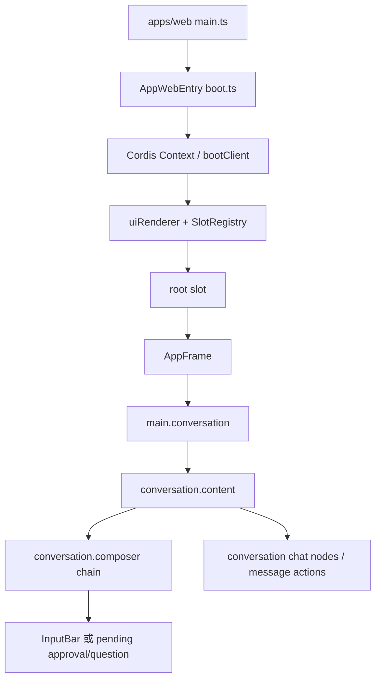

# dsh Web 前端源码导读与 Android 视觉映射

本文以官方 `dsh-v0.2.0-rc.2` 源码为 Web 侧依据，以该 tag 的 archive SHA-256 `c126f2f5dc56820e62d07e52eba6455cc20fffb379fc876626993452d86d4010` 固定审计对象。官方仓库链接均固定在该 tag，便于后续逐行复核。运行时颜色取自本次 rc.2 Web 页面 `getComputedStyle` 观测记录 [`runtime-observations.json`](../qa/web-visual-fidelity/runtime-observations.json)，Android 侧以本项目的 `MainActivity.kt`、`AppTheme.kt` 和 `res/drawable` 为准。

本文解释前端如何启动、插件如何贡献界面，以及本轮 Android 视觉映射实际覆盖的资源和控件。它不声称 Android 与桌面 Web 的布局、字号、滚动高度、悬停、阴影或所有弹窗达到逐像素一致。Web CSS 的 `px` 也不等于 Android `dp`；Android 保留 48dp 触控格，在格内居中绘制更接近 Web 的视觉图形。

## 从桌面入口到 React renderer

Web 浏览器入口在 [`apps/web/src/main.ts`（1–39 行）](https://github.com/deepseek-ai/deepseek-harness/blob/dsh-v0.2.0-rc.2/apps/web/src/main.ts#L1-L39)。入口先引入品牌字体和 `AppWebEntry`，在桌面桥接环境中处理 host 注入与启动错误，然后挂载应用入口。桌面宿主的 `ready()`、transport 注入和启动 gate 都在入口中完成；这些步骤负责让运行环境就绪，不负责绘制消息或按钮。

`AppWebEntry` 位于 [`packages/client/web/src/boot.ts`（23–97 行）](https://github.com/deepseek-ai/deepseek-harness/blob/dsh-v0.2.0-rc.2/packages/client/web/src/boot.ts#L23-L97)。它建立 boot page，等待所需服务就绪，读取模块清单和预加载模块，再创建 Cordis `Context`，调用 `bootClient` 并最终 `mountClient`。Renderer 在 [`ui-renderer/src/client/index.ts`（23–98 行）](https://github.com/deepseek-ai/deepseek-harness/blob/dsh-v0.2.0-rc.2/packages/client/ui-renderer/src/client/index.ts#L23-L98) 提供 UI renderer 服务：创建 slot registry、安装 slot renderer、向插件 context 提供 `uiRenderer.mount`，再形成 React render app。根 React 树由 [`ui-renderer/src/client/app.tsx`（1–21 行）](https://github.com/deepseek-ai/deepseek-harness/blob/dsh-v0.2.0-rc.2/packages/client/ui-renderer/src/client/app.tsx#L1-L21) 从 `root` slot 渲染。

Cordis 的插件结构把服务与界面贡献分开：插件注册服务、状态与 slot 贡献，renderer 再消费这些贡献。`root` slot 是应用壳的入口；registry 文档说明 root 由 `AppFrame` 占据，其他 slot 在其内部嵌套或追加，见 [`ui-renderer/src/client/registry.ts`（1–10 行）](https://github.com/deepseek-ai/deepseek-harness/blob/dsh-v0.2.0-rc.2/packages/client/ui-renderer/src/client/registry.ts#L1-L10)。这解释了为什么 approval 和 question 插件无需接管整个页面，就能替换 conversation composer 的内容。

## AppFrame、conversation 与 composer slot

`AppFrame` 是 shell 布局容器，不是聊天逻辑本身。其模块说明和依赖入口见 [`ui-layout/src/client/AppFrame.tsx`（1–42 行）](https://github.com/deepseek-ai/deepseek-harness/blob/dsh-v0.2.0-rc.2/packages/client/ui-layout/src/client/AppFrame.tsx#L1-L42)：左侧 sidebar、中间 main panel、右侧 rightbar 都由 frame 组织；main panel 根据 active panel 选择相应内容。具体 frame DOM 在 [`AppFrame.tsx`（258–302 行）](https://github.com/deepseek-ai/deepseek-harness/blob/dsh-v0.2.0-rc.2/packages/client/ui-layout/src/client/AppFrame.tsx#L258-L302) 输出 sidebar、main、rightbar、overlay 和附加 seat。`ConversationRoot` 则是 conversation 主面板的骨架，见 [`ui-conversation/.../ConversationRoot.tsx`（1–12 行）](https://github.com/deepseek-ai/deepseek-harness/blob/dsh-v0.2.0-rc.2/packages/client/ui-conversation/src/client/skeleton/ConversationRoot.tsx#L1-L12)。

Conversation 插件声明 `main.conversation`、`conversation.content` 和 `conversation.composer` 等 slot。尤其 `conversation.composer` 是 session 范围的 chain，`conversation.composer.bar` 是可选的单一 seat；composer bar 又声明附件、overlay、permission、left、plan、right、model、activity 和 dock 等子位。定义分别见 [`ui-conversation/src/client/apply.ts`（302–330 行）](https://github.com/deepseek-ai/deepseek-harness/blob/dsh-v0.2.0-rc.2/packages/client/ui-conversation/src/client/apply.ts#L302-L330) 与 [`apply.ts`（420–432 行）](https://github.com/deepseek-ai/deepseek-harness/blob/dsh-v0.2.0-rc.2/packages/client/ui-conversation/src/client/apply.ts#L420-L432)。`InputBar` 消费这些 slots 来排列附件、模式、工具和发送控件，而不是把所有插件控件硬编码到一张组件里；组件责任与各 slot 的实际渲染见 [`skeleton/InputBar.tsx`（1–14、418–503 行）](https://github.com/deepseek-ai/deepseek-harness/blob/dsh-v0.2.0-rc.2/packages/client/ui-conversation/src/client/skeleton/InputBar.tsx#L418-L503)。

消息下方的反馈、复制等动作由 chat 层渲染，而不是 composer。[`ui-chat/src/client/chat/MessageIconActions.tsx`（1–110 行）](https://github.com/deepseek-ai/deepseek-harness/blob/dsh-v0.2.0-rc.2/packages/client/ui-chat/src/client/chat/MessageIconActions.tsx#L1-L110) 绑定动作和图标；相邻样式 [`MessageIconActions.module.css`（1–91 行）](https://github.com/deepseek-ai/deepseek-harness/blob/dsh-v0.2.0-rc.2/packages/client/ui-chat/src/client/chat/MessageIconActions.module.css#L1-L91) 规定 28px 控件、圆角和 hover/focus 显示行为。Android 对应的消息动作目前保留 48dp 点击格，因此触控边界大于 Web 图形尺寸。

## Approval 与 user question 如何接管 composer

Approval 插件把待确认操作注册到 composer chain，并按 pending approval 选择要显示的 composer；审批组件使用通用 Button 和 StateDot，再通过 `pending.answer(...)` 返回 allow/reject 结果。插件注册在 [`ui-approval/src/client/index.ts`（74–104 行）](https://github.com/deepseek-ai/deepseek-harness/blob/dsh-v0.2.0-rc.2/packages/client/ui-approval/src/client/index.ts#L74-L104)，卡片主体在 [`ApprovalPanel.tsx`（1–98 行）](https://github.com/deepseek-ai/deepseek-harness/blob/dsh-v0.2.0-rc.2/packages/client/ui-approval/src/client/ApprovalPanel.tsx#L1-L98)。样式定义可见 [`ApprovalPanel.module.css`（1–67 行）](https://github.com/deepseek-ai/deepseek-harness/blob/dsh-v0.2.0-rc.2/packages/client/ui-approval/src/client/ApprovalPanel.module.css#L1-L67)：卡片用 input-major 背景、警示边框与 warning strip；正文区域自行滚动，操作按钮由共享 Button 样式提供。

Question 插件同样注入 `conversation.composer`，通过 selector 只匹配 `PendingQuestion`，并把对应 `QuestionComposer` 注册为 chain 项；注册代码在 [`ui-user-questions/src/client/index.ts`（369–395 行）](https://github.com/deepseek-ai/deepseek-harness/blob/dsh-v0.2.0-rc.2/packages/client/ui-user-questions/src/client/index.ts#L369-L395)。组件根据请求种类呈现普通问题或 plan review，具体表单、选项、进度和提交入口见 [`QuestionComposer.tsx`（433–624 行）](https://github.com/deepseek-ai/deepseek-harness/blob/dsh-v0.2.0-rc.2/packages/client/ui-user-questions/src/client/QuestionComposer.tsx#L433-L624)。Android 的当前实现保留已有问题/审批状态、滚动和回答路径；本轮对问题卡做的视觉映射是卡片底色与圆角，未拆分 header 或输入控件的状态结构。

## 主题安装与语义颜色

主题插件把 base、corner-shape、design-platform、focus、onboarding、scrollbar 等样式以内联 CSS 注入 `<head>`，并随插件生命周期移除；安装过程见 [`ui-theme/src/client/styles.ts`（1–39 行）](https://github.com/deepseek-ai/deepseek-harness/blob/dsh-v0.2.0-rc.2/packages/client/ui-theme/src/client/styles.ts#L1-L39)。Boot 阶段先选定明暗主题并应用 data attribute，避免 shell 首帧出现错误底色，见 [`ui-theme/src/boot-theme.ts`（11–52 行）](https://github.com/deepseek-ai/deepseek-harness/blob/dsh-v0.2.0-rc.2/packages/client/ui-theme/src/boot-theme.ts#L11-L52)。实际语义 token 在 [`design-platform.css`](https://github.com/deepseek-ai/deepseek-harness/blob/dsh-v0.2.0-rc.2/packages/client/ui-theme/src/styles/design-platform.css) 中定义。静态调色板包括中性深色 `rgb(21,21,23)`、`rgb(44,44,46)`、`rgb(53,54,56)` 以及品牌蓝 `rgb(122,170,255)`，对应文件 26、70–74 行；按钮 alias 在 203–205 和 321–323 行分别按主题配置。

运行时采样确认以下 dark 值。要按语义而不是 CSS 变量名称猜用途：`bgBase=#151517`；正文 primary 与 `alias-brand-primary` / `button-primary-fill` 都为 `#f9fafb`；发送按钮使用的是 `button-info-fill=#7aaaff`；composer/input-major 为 `#2c2c2e`；warning primary、secondary、tertiary 分别为 `#f59e0b`、`#f7ad31`、`#27241f`。因此 `button-primary-fill` 在 dark theme 是浅色前景色语义的填充，不是品牌蓝；蓝色发送按钮走 `button-info-fill`。Android 当前 `AppTheme.kt` 分别把这些映射到 palette 背景、文字、`primaryButtonFill`、`COLOR_BLUE`、composer 和 approval border 字段。亮色主题有不同的 surface/foreground 配对；不要把 dark 值机械套用到所有状态。

下表把实测值直接对应到 Android 的角色，避免把外观相似的颜色混用：

| Dark Web 语义 | 实测值 | 本轮 Android 映射 |
| --- | --- | --- |
| bgBase | `#151517` | surface |
| inputMajor | `#2c2c2e` | composer；approval/question 卡片 |
| labelPrimary | `#f9fafb` | text |
| labelSecondary / labelTertiary | `#cfd3d6` / `#adb2b8` | controlText / muted |
| buttonPrimaryFill | `#f9fafb` | approval 主按钮 |
| buttonInfoFill | `#7aaaff` | send 蓝色底圆 |
| warnPrimary / warnSecondary | `#f59e0b` / `#f7ad31` | 警示文字 / approvalBorder |
| warnTertiary | `#27241f` | approvalStrip |

## Button 尺寸、状态与触控映射

共享 Button 组件的 DOM 语义在 [`ui-primitives/src/Button.tsx`（1–80 行）](https://github.com/deepseek-ai/deepseek-harness/blob/dsh-v0.2.0-rc.2/packages/client/ui-primitives/src/Button.tsx#L1-L80)，视觉变量在 [`Button.module.css`（1–76 行）](https://github.com/deepseek-ai/deepseek-harness/blob/dsh-v0.2.0-rc.2/packages/client/ui-primitives/src/Button.module.css#L1-L76)。该 CSS 有 medium/small 控件尺寸、圆角 alias、禁用态 opacity `.4` 等共用规则。审批按钮 Android 侧采用 12dp 圆角、disabled alpha `.4` 和 ripple，按钮最小触控高度仍是 48dp。此处是控件外观适配，不改变 enable 条件、文本或审批动作。

`Button` 采用原生 `<button type="button">`，默认 `ghost`、`md`，通过 `forwardRef` 把原生元素交给焦点管理；其余 HTML attributes 直接透传。样式随 `variant`、`size` 组合，不依赖浏览器默认按钮外观。四种 variant 是 primary、ghost、outline、toolbar；hover 使用各自语义背景 token，disabled 禁止这些 hover 分支并降低整体透明度。

| Web 控件 | CSS 尺寸与形状 | 还原时要区分的细节 |
| --- | --- | --- |
| Button md | 高 36px，14px 字号/22px 行高，横向 padding 14px，圆角 12px | approval 使用该基础规则；Android 保留 48dp 最小触控高 |
| Button sm | 高 28px，12px 字号/18px 行高，padding 10px，圆角 8px | 与 filled/outline variant 无关 |
| Button outline | 0.5px border-l3 边框 | 本轮 Android 边框尚非 0.5px 像素标定 |
| message action | 28px 格，padding 6px，glyph 16px，圆角 8px | Android glyph 对齐，点击格为 48dp |
| composer add | 28px 圆，glyph 14px，Medium 1.3 stroke | Android `InsetDrawable(10dp)` 放在 48dp 格内 |
| composer send | 34px 圆，glyph 16px，白色箭头，disabled .4 | Android `InsetDrawable(7dp)` 放在 48dp 格内 |
| sidebar toggle | 28px 格，glyph 16px，Regular 1 stroke | Web 与 Android drawer 触控区域没有全部统一 |
| new session | 高 38px，圆角 12px，0.5px 透明边框，glyph 14px | Android 当前 intrinsic 16dp，实际入口缩放需另做像素验收 |

Composer 的 Web 主卡由 [`InputBar.module.css`（50–77 行）](https://github.com/deepseek-ai/deepseek-harness/blob/dsh-v0.2.0-rc.2/packages/client/ui-conversation/src/client/skeleton/InputBar.module.css#L50-L77) 定义圆角、input-major 背景与边框细节；加号附件按钮在 `InputBar.tsx` 431 行使用 14px 图标；发送按钮由同目录 `InputBar.module.css` 369–400 行定义，为 34px 圆形，使用 `button-info-fill`、白色箭头，禁用时 opacity `.4`。Android 将发送圆画为 34dp、加号按钮底圆画为 28dp，但都在 48dp 触控格中居中；不通过缩小点击区域来追求桌面视觉尺寸。Android `updateSendState` 继续使用原有 `running || (composer enabled && hasDraft)` enable 条件，初始状态与更新状态共用同一视觉 helper：空输入 alpha `.4`，可用态 alpha `1`，箭头保持白色。

Web sidebar 的 28px 图形尺寸也不等于触控区尺寸；Android drawer 现有紧凑控件尺寸和个别未达 48dp 的区域本轮没有重构，应作为后续触控可用性差距继续记录。桌面 Web 的 hover（例如 message actions）在 Android 没有同等 hover 设备语义，本轮没有声称两端 hover 或 pressed 动画一致。

## 图标来源与 Android drawable 对照

本轮 15 个 Android vector drawable 按 rc.2 Web SVG 的 `viewBox`、path 几何、颜色继承方式和对应语义映射。清单与内容哈希记录在 [`icon-source-manifest.json`](../qa/web-visual-fidelity/icon-source-manifest.json)。Web primitives 的 SVG artwork 和 Regular/Medium wrapper 位于 [`icons/index.tsx`](https://github.com/deepseek-ai/deepseek-harness/blob/dsh-v0.2.0-rc.2/packages/client/ui-primitives/src/icons/index.tsx#L37-L165)；copy/feedback artwork 还见 [`icons/index.tsx`（300–395 行）](https://github.com/deepseek-ai/deepseek-harness/blob/dsh-v0.2.0-rc.2/packages/client/ui-primitives/src/icons/index.tsx#L300-L395)，Think artwork 在 451–466 行。New Chat 共用 artwork 位于 [`icons/shared-artwork.tsx`（1–40 行）](https://github.com/deepseek-ai/deepseek-harness/blob/dsh-v0.2.0-rc.2/packages/client/ui-primitives/src/icons/shared-artwork.tsx#L1-L40)。搜索、设置、plus、copy/check、like/dislike、branch、think 等均由 `icons/index.tsx` 输出；send 和 stop 方形图标由 InputBar 本地 SVG 提供，分别在 [`InputBar.tsx`（476–503 行）](https://github.com/deepseek-ai/deepseek-harness/blob/dsh-v0.2.0-rc.2/packages/client/ui-conversation/src/client/skeleton/InputBar.tsx#L476-L503)。

| Android drawable | Web 来源（rc.2） | 当前用途与映射说明 |
|---|---|---|
| `ic_sidebar_outline.xml` | `IconPanelLeftOutlineArtwork`，`ui-primitives/icons/index.tsx` | Drawer/sidebar 切换；Web 16 viewBox、1px stroke |
| `ic_new_session_harness.xml` | `NewChatOutlineArtwork`，`icons/shared-artwork.tsx` | 新建会话；Web 16 viewBox、Medium 1.3px stroke。几何包含圆弧尾，与 Android 原轮廓对应，不应概括为“圆环换气泡” |
| `ic_search_outline.xml` | `IconSearchOutlineArtwork`，`icons/index.tsx` | 搜索；Web 16 viewBox，在对应入口按 14px 使用 |
| `ic_settings_outline.xml` | `IconSettingsOutlineArtwork`，`icons/index.tsx` | 设置；Web 16 viewBox、Medium 1.3px stroke |
| `ic_add_outline.xml` | `IconPlusOutlineArtwork`，`icons/index.tsx` | composer 添加附件；Web 14px、16 viewBox、1.3px stroke |
| `ic_copy_outline_16.xml` | `IconCopyOutlineArtwork`，`icons/index.tsx` | 复制消息；Web 16px、1px stroke |
| `ic_check_outline_16.xml` | `IconCheckOutlineArtwork`，`icons/index.tsx` | 复制成功反馈；Web 16px、1px stroke |
| `ic_like_outline_16.xml` | `IconLikeOutlineArtwork`，`icons/index.tsx` | 未选择的正向反馈；复用 outline 几何 |
| `ic_dislike_outline_16.xml` | `IconDislikeOutlineArtwork`，`icons/index.tsx` | 未选择的负向反馈；复用 outline 几何 |
| `ic_like_fill_16.xml` | `IconLikeFillArtwork`，`icons/index.tsx` | 正向反馈已选中；与未选中图标状态相配 |
| `ic_dislike_fill_16.xml` | `IconDislikeFillArtwork`，`icons/index.tsx` | 负向反馈已选中；与未选中图标状态相配 |
| `ic_branch_outline_16.xml` | `IconBranchOutlineArtwork`，`icons/index.tsx` | 分支消息动作 |
| `ic_think_harness.xml` | `IconThinkOutlineArtwork`，`icons/index.tsx` | Think 控件 |
| `ic_send_harness.xml` | `InputBar.tsx` send SVG | composer 发送箭头；16 viewBox、纯 fill path |
| `ic_stop_square.xml` | `InputBar.tsx` stop SVG | 生成中停止方块；16 viewBox、纯 fill path |

SVG 的 `<path fill="currentColor">` 并不意味着几何必然是实心图案：有些复合路径用 fill 绘制仍形成视觉上的空心轮廓。对照时应看 path 几何、负空间、viewBox、stroke/fill 和尺寸，不能仅由 `fill` 属性判断“更粗”或“实心”。同理，原 Android like/dislike 虽是单一填充 compound path，视觉上仍呈轮廓样式；本轮差异重点是匹配 Web 的具体手形、袖口和路径结构，并增加 Web 对应的 selected fill drawable，而不是泛化成 outline 与全实心的二分。

## 本轮确实完成的视觉映射

Android `MainActivity.kt` 与 `AppTheme.kt` 当前变更覆盖以下已核对范围：

- 15 个图标 drawable 替换/新增为 rc.2 对应 SVG 几何；like/dislike 选中态使用新建 fill 资源，未选中态使用 outline 对应资源。资源的来源和哈希见上述清单。
- composer 外卡片使用 28dp 圆角；问题卡使用 `COLOR_COMPOSER` 填充和 20dp 圆角；approval 卡使用同一 composer 填充、approval border 调色与 20dp 圆角。原卡片滚动区、头部和内部控件层级保持原样。
- Approval 按钮改为 12dp 圆角、disabled `.4` alpha 和 ripple，仍至少 48dp 高，保留多行文字空间。
- Composer add 控件的视觉底圆为 28dp，背景 `COLOR_CONTROL`，14dp plus glyph 着色为 `COLOR_TEXT`；其 48dp 点击格保留。
- Send 控件视觉圆为 34dp，使用 Web info/send 蓝色和白色 16dp glyph；48dp 点击格保留。空输入用 `.4` alpha，更新与初始态共用 helper，且原 enabled 条件不变。
- 消息动作视觉圆角/反馈背景为 8dp，动作 hit cell 仍为 48dp；复制、分支和反馈动作的点击、选择状态逻辑不变。
- 待处理审批提醒只做视觉映射，显示条件和导航逻辑保留。

Android 值在 `MainActivity.kt` 的 `buildComposer`、`approvalButton`、问题卡/审批卡与消息 action 方法中实现；颜色语义由 `AppTheme.kt` 的 palette 字段集中提供。Android 当前 drawer 图标已映射，但 drawer 紧凑按钮的命中尺寸本轮没有统一为 48dp。

## 尚未承诺像素一致的区域

本轮以高辨识度小图标、底色、控件圆角和局部按钮状态为目标。没有做 Web/Android 整页截图逐像素标定，因此以下仍然是未做逐像素还原验收的范围（键盘、主题和大字体的独立功能检查见本轮 QA）：整体布局宽度与断点、消息气泡间距、字号/行高/字体渲染、文本换行差异、键盘与滚动定位、阴影模糊半径、悬停/焦点/pressed 动画、弹窗与菜单的全部样式、Android 系统字体缩放、Web CSS px 到设备 dp 的精确换算。Web approval 卡有 `box-shadow` 和独立 warning strip；本轮 Android 保留卡片结构，没有宣称阴影及每个内部间距一致。未映射弹窗继续沿用 Android 当前实现，不从本轮局部色值推导。

官方源码引用采用 rc.2 tag；设计/审计衍生的 MIT 图标资源应随 Android app 保留上游 LICENSE 和来源记录。项目样式入口中存在 `design-platform.css`；本次审计没有发现 `design-business.css`，本文不以该名称指代任何主题文件。

本轮设计协作与 Gemini 阅读范围见 [分析来源记录](../superpowers/designs/web-visual-fidelity/provenance.md)，安装与实机记录见 [视觉验收](../qa/web-visual-fidelity/validation.md)。[图标对照页](../qa/web-visual-fidelity/icon-comparison.html)可切换明暗主题并放大；右栏是 Vector 几何投影，实际设备表现见验收截图。
