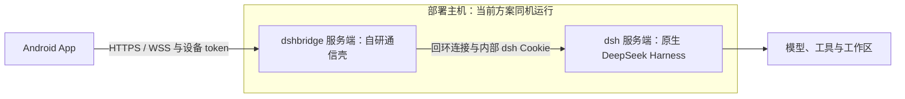

# dsh 服务端与 dshbridge 服务端

本项目统一使用两个服务端名称：**dsh 服务端**指 DeepSeek Harness 原生服务端；**dshbridge 服务端**指我们开发的通信壳。后续部署、配置、排障和版本说明都使用这两个名称，避免仅写“服务端”而无法确定组件。

## 职责与边界

| 项目 | dsh 服务端 | dshbridge 服务端 |
| --- | --- | --- |
| 来源 | DeepSeek Harness 原生服务 | 本项目自研 Go 服务，源码在 `bridge/` |
| 主要职责 | 执行 Agent 任务、调用模型、管理会话与工作区、生成业务状态和事件 | 设备配对、认证、撤销、随机入口、限定范围的 RPC/Remote mux/导出转发 |
| Web 页面 | 提供原生 dsh Web | 提供认证后的通信入口；原生 Web 仍在 dsh 服务端 |
| 在私有连接中的角色 | dshbridge 的回环上游 | Android 客户端连接的 HTTPS/WSS 入口 |
| 认证凭据 | dsh 启动 token 和原生 Cookie | 一次性配对码、独立的设备 token |
| 配置与数据 | 原生模型、会话、工作区等配置与数据 | 私有 state：`config.json`、`routes.json`、`auth.json` |
| 版本 | 使用官方 dsh 版本；本轮兼容 0.2.0-rc.2 | 独立维护的组件；当前外层协议为 `protocolVersion: 1` |

dshbridge 保留 dsh 的业务协议和状态语义。模型调用与任务执行发生在 dsh 服务端；dshbridge 验证设备身份并转发受支持的请求和事件。

## 连接与部署关系

这是两个独立的服务组件，当前方案要求它们运行在同一台主机上。分别启动和维护两个进程；当前 dshbridge 不自动管理 dsh 的启动、升级或停止。

本轮交付包 `server/` 中的 Windows、macOS 和 Linux 程序属于 dshbridge。原生 dsh 服务端需要单独安装、配置并启动；模型、工具与工作区配置由 dsh 管理。

私有部署时，dsh 服务端只监听回环地址，公网入口指向 dshbridge 服务端。TLS 可以由 dshbridge 或其前面的 TLS 反向代理终止；反向代理的目标是 dshbridge。原生 Web 管理在部署主机本地访问 dsh 服务端。

本机验收曾使用 `127.0.0.1:3080` 运行 dsh、`127.0.0.1:3090` 运行 dshbridge。这两个端口是测试配置，部署时按实际配置维护。截至 2026-10-10 本轮交付完成时，临时测试服务已关闭，尚未正式部署公网入口。

随后追加的 [Pixel 局域网验证](../qa/private-transport/lan-validation.md) 使用 dshbridge 的局域网 HTTPS 入口，配对、聊天和重启恢复均通过；该轮保留两个本机服务运行。局域网验证与前面的临时 USB 验证是两次独立运行，正式公网部署仍未进行。

## 参数与认证分别属于谁

| 项目 | 所指组件与用途 |
| --- | --- |
| `--upstream` | dsh 服务端的回环 origin，供 dshbridge 向上游连接 |
| `--public-origin` | dshbridge 服务端供客户端访问的 origin；公网部署使用实际 HTTPS 地址 |
| `--dsh-token-file` | 包含 dsh 原生启动 token 的私有文件，供 dshbridge 内部认证使用 |
| 手机配对资料中的 `origin`、`pairPath` | dshbridge 服务端地址及随机配对入口 |
| `pair` / `devices` / `revoke` | dshbridge 的本地设备管理命令 |
| 手机的设备 token | 向 dshbridge 认证，和内部 dsh 启动 token / Cookie 分开管理 |
| `routes.json` | dshbridge 的 pair / rpc / stream / export 随机路径映射 |

维护顺序是：先启动回环监听的 dsh 服务端，再配置并启动 dshbridge 服务端，最后用 dshbridge 生成的连接资料与配对码连接手机。

手机界面中的“私有服务 / Private server”对应 dshbridge；“直接连接 / Direct connection”对应原生 dsh。设备授权不可用时检查 dshbridge 的配对和撤销状态；上游不可用时检查 dsh 服务端进程、回环地址以及 dshbridge 的内部 dsh 凭据。

## 名称与现有程序文件

组件名称统一为 **dshbridge**。当前 CLI 命令和可执行文件仍是 `dsh-bridge`、`dsh-bridge-<platform>-<arch>`，源码入口是 `bridge/cmd/dsh-bridge/`；这些名称都属于 dshbridge 服务端。执行现有命令时使用实际文件名。

详细命令、认证流程和部署限制见 [dshbridge 操作说明](../../bridge/README.md)，本机验证结果见 [验收记录](../qa/private-transport/validation.md)。
